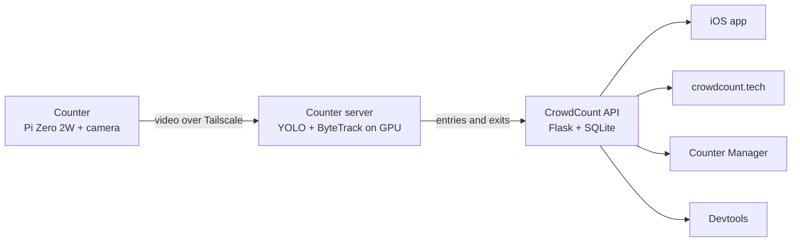

# CrowdCount

Live occupancy counting for small businesses. A small camera mounted above the door counts people walking in and out, and owners see live occupancy, history and busy-hour insights on their phone and on the web.

We built CrowdCount in Boulder, Colorado, from 2024 to 2026 and had counters running at about 25 local businesses in Boulder and Breckenridge. The company has since wound down. The code is published here, read-only, as a record of what we built. [crowdcount.tech](https://crowdcount.tech) still works, running on a read-only snapshot of the final data.

## How it works

Each counter streams video to a GPU server, which tracks people crossing the doorway and sends counts to the API. Owners and visitors then read those counts through the iOS app and the websites.

## Repositories

| Repository | What it does | Built with |
|---|---|---|
| [crowdcount-counter](https://github.com/Crowd-Count/crowdcount-counter) | Firmware for the doorway counter. Streams video, sets itself up over Bluetooth from a QR code, and joins the fleet network | Python, Raspberry Pi OS, libcamera, Tailscale |
| [crowdcount-counter-server](https://github.com/Crowd-Count/crowdcount-counter-server) | Takes every counter's stream and counts doorway crossings with our own trained YOLO models and ByteTrack | Python, Ultralytics YOLO, OpenCV, MediaMTX, Docker + CUDA |
| [crowdcount-server](https://github.com/Crowd-Count/crowdcount-server) | The cloud API. Stores counts and manages locations, overcrowding alerts, reports, push notifications and Square POS sync | Python, Flask, Gunicorn, SQLite, Docker, AWS |
| [crowdcount-ios](https://github.com/Crowd-Count/crowdcount-ios) | The iOS app ([App Store](https://apps.apple.com/us/app/crowdcount-app/id6523433094)): live counts, history, insights, a map of venues and alerts | Swift, SwiftUI, MapKit, Stripe |
| [crowdcount-web](https://github.com/Crowd-Count/crowdcount-web) | [crowdcount.tech](https://crowdcount.tech): the marketing site and a public map of live busyness and popular times | Next.js, React, MapKit JS |
| [crowdcount-counter-manager](https://github.com/Crowd-Count/crowdcount-counter-manager) | Web app where owners group counters into locations and view history and insights | Next.js, TypeScript, Tailwind, Recharts |
| [crowdcount-devtools](https://github.com/Crowd-Count/crowdcount-devtools) | Internal dashboard for fleet health, users and server status | Next.js, TypeScript, Recharts |
| [crowdcount-demo](https://github.com/elkanbruha/crowdcount-demo) | Early prototypes: a webcam counter and a Pi-to-server stream that finds the server on its own | Python, YOLO, Zeroconf |

## Things we're proud of

- **Our own detection models.** We trained several generations of our own YOLO person detectors and paired them with ByteTrack to count people crossing the doorway.
- **Hands-off hardware setup.** A new counter configures itself over Bluetooth when someone scans its QR code, then joins a Tailscale network, so the whole fleet could be managed remotely.
- **Production habits on a small team.** Signed API requests with idempotency keys, zero-downtime blue/green deploys behind Caddy, and per-location time zones for every chart and insight.
- **A clean shutdown.** When we wound down, the API moved to a small read-only AWS Lambda snapshot, so the website and apps keep working.

## Team

- [Elkan Bruha](https://www.linkedin.com/in/elkanbruha) ([@elkanbruha](https://github.com/elkanbruha)), Founder and Lead Engineer
- [Hayden Forbes](https://www.linkedin.com/in/hayden-forbes), Co-Founder and Business Lead
- [Josh D'Annunzio](https://www.linkedin.com/in/josh-dannunzio/) ([@Jdann14](https://github.com/Jdann14)), Computer Vision Lead
- [Eric Neverdasovs](https://www.linkedin.com/in/eric-neverdasovs-6a11b925a/), Product Designer and Manufacturer
- [Jake Pechart](https://www.linkedin.com/in/jake-pechart-2516732b9/), Legal Support
- AJ Arnold ([@ajarnold920](https://github.com/ajarnold920)), Engineering

---

All repositories are archived and read-only. © 2025–2026 CrowdCount LLC. All rights reserved.
